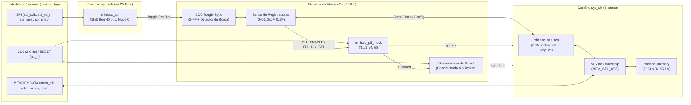

# Documento de Microarquitetura — MiniSoC AES (v1.0)

Nesta etapa, elaborei o documento com a microarquitetura interna dos blocos que fazem parte do módulo de topo `minisoc_top.sv`. O texto descreve como cada parte será implementada na prática, seguindo o que já está definido no *Block Guide* v1.0.0: as interfaces externas (`CLK`, `RESET`, `SPI` e `MEMORY DATA`), a divisão entre os quatro módulos principais (`minisoc_spi`, `minisoc_pll_mock`, `minisoc_aes_top` e `minisoc_memory`) e o mapa de registradores (`0x00` a `0x0F` e `0x3F`).

---

## 1. Diagramas de Blocos Internos

### 1.1 Visão de Topo (`minisoc_top.sv`)
A arquitetura interliga os quatro blocos principais através de três domínios de clock distintos (`spi_sclk`, `clk` *always-on* e `sys_clk`), com arbitragem exclusiva da SRAM de 1024 × 32 bits controlada por `SYSTEM_CONTROL.MEM_SEL_AES`.

1.2 Arquitetura Interna do Núcleo AES

O núcleo divide-se na máquina de estados de controle, na expansão de chaves (minisoc_aes_key_exp.sv) e no datapath iterativo (minisoc_aes_dp.sv).

2. Microarquitetura do Núcleo AES (Iterativa — 1 Rodada/Ciclo)

Adotou-se uma arquitetura iterativa de 1 rodada por ciclo, na qual um único estágio combinacional de rodada é reutilizado ao longo de 10 ciclos (para chaves de 128 bits), somados a 1 ciclo inicial de AddRoundKey. Essa abordagem reduz drasticamente a área de silício e o consumo de potência em comparação a arquiteturas unrolled ou pipelined, atendendo com ampla folga à taxa de transferência limitada pela interface serial SPI (até 25 MHz).

Alternância entre Cifragem e Decifragem: Controlada pelo bit AES_CONTROL.DECRYPT (com exceção dos modos CTR, CFB e OFB, que utilizam apenas o fluxo direto).

Fluxo Direto (DECRYPT == 0): Aplica AddRoundKey inicial com RK[0] e executa 10 ciclos de SubBytes -> ShiftRows -> MixColumns -> AddRoundKey(RK[r]), suprimindo MixColumns na 10ª rodada.

Fluxo Inverso (DECRYPT == 1): Aplica AddRoundKey inicial com RK[10] e executa 10 ciclos de InvShiftRows -> InvSubBytes -> AddRoundKey(RK[10-r]) -> InvMixColumns, suprimindo InvMixColumns na 10ª rodada.

3. Máquina de Estados Finitos (FSM de Controle)

A FSM do minisoc_aes_top coordena a leitura/escrita da SRAM, a expansão de chaves e as iterações do datapath:

4. Estratégia de CDC (spi_sclk $\leftrightarrow$ clk)

Para cruzar com segurança do domínio lento do clock serial (spi_sclk $\le$ 25 MHz) para o domínio always-on (clk = 2 GHz) sem metaestabilidade, utiliza-se sincronização por toggle:Captura no Domínio spi_sclk: Um registrador de deslocamento acumula os 40 bits do frame SPI Mode 0 (RWb, ADDR[5:0], RSV, DATA[31:0]). Ao atingir o 40º bit com spi_cs_n == 0, os barramentos de endereço, comando e dado são estabilizados e um flip-flop inverte seu estado (req_toggle <= ~req_toggle).Sincronização no Domínio clk: O sinal req_toggle atravessa dois flip-flops em cascata (sync_ff1, sync_ff2) para eliminar metaestabilidade.Detecção de Borda: Um terceiro flip-flop (sync_ff3) registra sync_ff2, e a operação pulse_1clk = sync_ff2 ^ sync_ff3 gera um pulso limpo de exatamente 1 ciclo de clk para executar a escrita no banco de registradores (RWb == 0) ou carregar o dado de resposta para o próximo frame SPI (RWb == 1).

5. Sequência de Reset do Domínio do Sistema

O reset do domínio sys_clk (sys_rst_n) implementa asserção assíncrona e liberação síncrona condicionada ao travamento do PLL (o_locked):

Asserção Assíncrona: Sempre que o reset global rst_n == 1'b0 ou o PLL estiver desabilitado/destravado (o_locked == 1'b0), sys_rst_n é forçado imediatamente a 1'b0, mantendo o minisoc_aes_top em estado seguro.

Liberação Síncrona: Após rst_n retornar a 1'b1 e o minisoc_pll_mock estabilizar sys_clk ativando o_locked == 1'b1, um sincronizador de 2 estágios (rst_sync_ff1, rst_sync_ff2) propagará o nível lógico 1'b1 na borda de subida de sys_clk. Dessa forma, sys_rst_n é liberado de maneira determinística exatamente 2 ciclos de sys_clk após o travamento do PLL.

